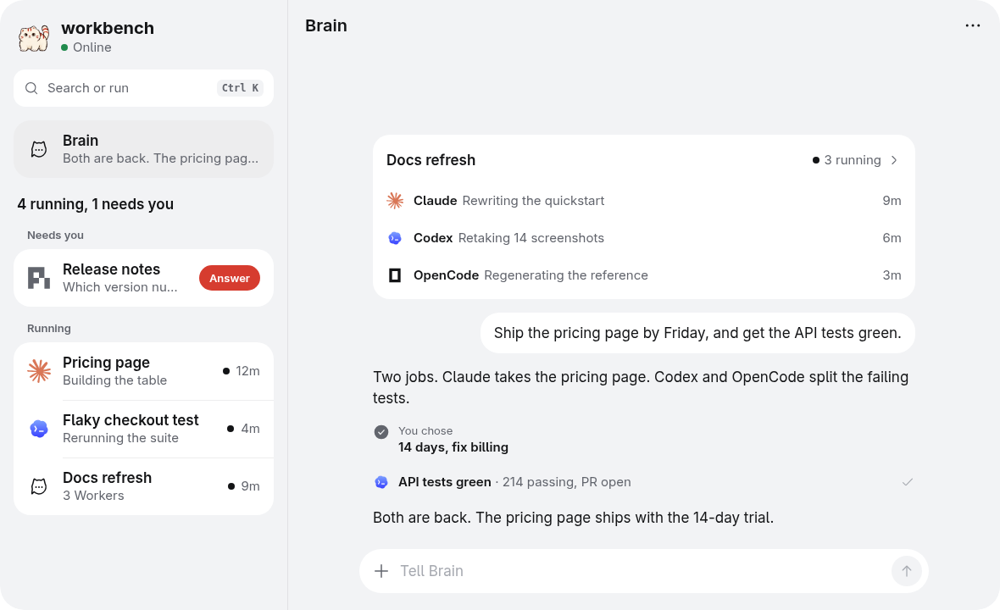
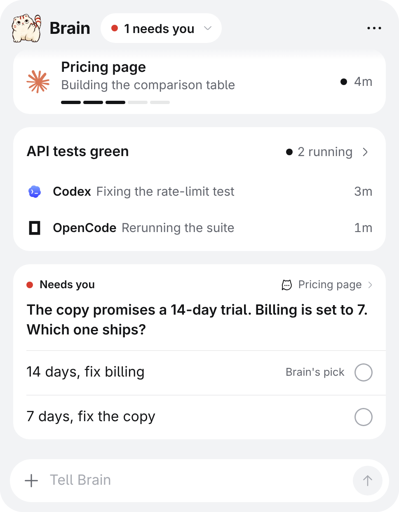

<p align="center">
  
</p>

<h1 align="center">Mewla</h1>

<p align="center">
  <strong>Naps all day. Ships all night.</strong><br>
  Tell Brain the goal. It leads a team of coding agents on your own computer, and calls you only when it matters.
</p>

<p align="center">
  <a href="https://github.com/daoleno/mewla/releases"></a>
  <a href="https://github.com/daoleno/mewla/actions/workflows/ci.yml"></a>
  <a href="LICENSE"></a>
</p>

<p align="center">
  <picture>
    <source media="(prefers-color-scheme: dark)" srcset="docs/assets/mewla-brain-wide-dark.png">
    
  </picture>
  <br><sub>Demo data.</sub>
</p>

Mewla is a phone app and a small daemon that runs next to your repositories.
The agents are the CLIs you already use (Claude Code, Codex, Cursor, Grok, Pi,
OpenCode), each in a real terminal on your machine. Mewla gives them a
lead and gives you a remote. Open source, self-hosted, in beta.

[Homepage](https://mewla.ai/) · [Docs](https://mewla.ai/docs/) · [Releases](https://github.com/daoleno/mewla/releases)

## How it works

1. **Say it once.** "Ship atlas-notes v1.4 this week: fix the sync bug, tidy
   the settings copy, write release notes." In the app, or from Telegram.
2. **Brain splits it into Work** and picks an agent for each part, following
   `routing.md`, a file you edit.
3. **Real agents do it**, each in its own terminal on your computer. Read any of them as
   Chat or as the live Terminal, or take over from your phone.
4. **You hear about it only when it matters**: a push when an agent needs you,
   fails or finishes. In the app, its question comes with the answers as buttons.
5. **Nothing ships unchecked.** Brain reviews every result before it counts as
   done, and only Brain or you can close Work.

<p align="center">
  <picture>
    <source media="(prefers-color-scheme: dark)" srcset="docs/assets/mewla-phone-dark.png">
    
  </picture>
  <br><sub>Brain on a phone. Demo data.</sub>
</p>

Around that loop: Calendar for things Brain should run later, Extensions so Brain
can read Linear, Notion and GitHub, your own model keys, usage and cost per
model, and a live view of what agents use on the machine.

## Get started

You need Linux (`amd64`/`arm64`), an Apple Silicon Mac or Windows (x64). On
Linux and macOS, `mewla` offers to install an agent CLI (Claude Code or Codex)
when none is ready.

```sh
# 1. Install: checksum-verified, no telemetry
curl -fsSL https://mewla.ai/install.sh | sh     # Linux, macOS
irm https://mewla.ai/install.ps1 | iex          # Windows, in PowerShell

# 2. Start; press Enter to accept each suggestion and sign in with GitHub
mewla
```

3. Install the app: the Android arm64 APK from
   [Releases](https://github.com/daoleno/mewla/releases), or
   [iOS on TestFlight](https://testflight.apple.com/join/nMQheDCE)
   ([or build from source](docs/install-daemon.md#ios)).
4. Scan the QR code, then tell Brain a goal. To start an agent yourself, tap
   the state control next to **Brain** and then **+**. For later phones and
   browsers, run `mewla pair`.

Other ways to connect, such as the same Wi-Fi only or Tailscale, are in
[Connect and pair](docs/connect-and-pair.md). The full path is in
[Get started](docs/get-started.md).

> [!WARNING]
> Every agent Mewla launches runs with full authority: no approval prompts, no
> sandbox. On a machine with secrets or production access, read
> [Permission bypass risks](docs/executors.md#permission-bypass-risks) first.

## Status

| Part | Status |
| --- | --- |
| Daemon: Linux `amd64`/`arm64`, WSL2, Apple Silicon macOS, Windows x64 | Beta |
| Android app (arm64 APK) | Beta |
| iOS app | Beta on [TestFlight](https://testflight.apple.com/join/nMQheDCE) |
| Web UI, served by the daemon | Beta; no QR scanning or push |
| Extensions | Preview; sign-in is not ready for every service |

Known issues: [Releases](docs/releases/README.md#known-issues).

## Documentation

- **Get it running:** [Get started](docs/get-started.md) · [Install and update](docs/install-daemon.md) · [Connect and pair](docs/connect-and-pair.md)
- **Use it:** [Sessions](docs/sessions.md) · [Brain and Work](docs/brain-and-work.md) · [Notifications and Telegram](docs/notifications.md) · [Calendar](docs/calendar.md) · [Extensions](docs/extensions.md)
- **Configure it:** [Agents and models](docs/executors.md) · [Usage and resources](docs/usage-and-resources.md)
- **Reference:** [Commands](docs/cli.md) · [Security and privacy](docs/security-and-privacy.md) · [Troubleshooting](docs/troubleshooting.md)

## Develop

```sh
bun install                           # workspace dependencies (Bun 1.3)
bun run daemon:build                  # builds bin/mewla
cd daemon && go test ./...
cd app && bun test && bunx tsc --noEmit
```

The daemon is Go in `daemon/`, the app is Expo/React Native in `app/`. Start
with [CONTRIBUTING.md](CONTRIBUTING.md), [AGENTS.md](AGENTS.md) and
[Architecture](docs/architecture.md). Report vulnerabilities as described in
[SECURITY.md](SECURITY.md).

## License

Apache License 2.0; see [LICENSE](LICENSE) and [NOTICE](NOTICE). The Mewla name
and seal-cat logo are covered by [TRADEMARKS.md](TRADEMARKS.md).
