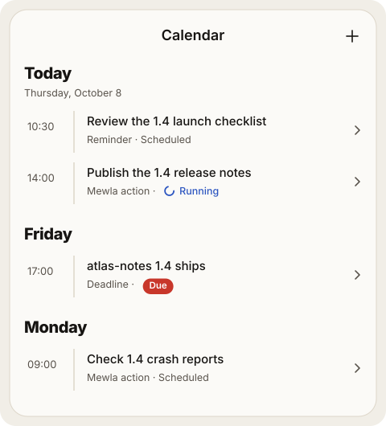

# Calendar

Calendar is Mewla's view of time: what happens when. Open it from the menu
(☰, or the sidebar on a wide screen). It lives on the daemon and syncs to the
app, so it belongs to the current server like everything else.

## Item kinds



| Kind | Has | What happens when it is due |
| --- | --- | --- |
| Event | A start and an end | Shows as running during the interval, then completes |
| Reminder | A notify time | Your phone shows a notification and the item waits for you |
| Deadline | A due time | The item waits for you |
| Scheduled action | A due time and an instruction | An agent runs the instruction as Work and reports back to Brain |

In the app, an item that waits for you shows the red **Needs you** mark;
running, done, failed and cancelled items use the same marks as Work. Each row
says what the item does in one line.

Open an item to see:

- its schedule in words ("Every day at 8:30 PM · Next: tomorrow 8:30 PM"),
  with the timezone only when it differs from your phone's;
- what it does, in one line; a scheduled action's full instructions are one
  tap away under **Instructions**;
- its runs, newest first: the date, how it went and the first line of what it
  produced. Tap a run to read its whole result, or why it failed. A run still
  in progress opens its live Session, and so does tapping a running item in the
  agenda.

You enter a local date, a local time and a timezone. Items can repeat daily,
weekly or on weekdays, and keep their local time across daylight-saving
changes. A time that does not exist on a daylight-saving day is rejected; a
time that occurs twice asks you to choose the first or second occurrence.

## Scheduled actions

A scheduled action is a small job for an agent: "At 09:30 on weekdays,
summarise yesterday's merged pull requests." When it is due, Mewla:

1. creates a visible Work item and starts the agent in its own Session, on
   your default scheduled-action Worker, or the executor the action itself
   names (see below). It never uses Brain's executor;
2. waits for that Work to finish or fail;
3. posts the result to the Brain thread where you created the action, and
   sends one push notification that opens that thread.

The Work and the Session it starts say where they came from: a calendar glyph
and the schedule's name and date ("运营：挖稿 · Oct 27") on the Work rail, the
Work page, the Session's row in Sessions and the Session's header. Tap it to
open that run in Calendar.

Each occurrence runs at most once, even across daemon restarts. A recurring
action moves on to its next time after a success or a failure; the failed run
keeps the reason, and the item itself is simply scheduled again. If the daemon was down when an action was due, it
runs on startup only if it is at most 15 minutes late; older ones are marked
failed so stale work does not start unexpectedly. Use **Run now** to run one on
demand.

Scheduled actions run unattended; see
[Permission bypass risks](executors.md#permission-bypass-risks).

## Persistent loops

A **loop** is a goal Mewla keeps checking until it is met. It is an
`until_done` Work whose next check is a durable `due_retry` wake, so it belongs
to Mewla, not to the agent that started it. Replacing the Brain executor
(Claude to Codex and back) or restarting the daemon does not stop or duplicate
it; the check always goes to whichever Brain is the Host when it is due. Do not
use a provider's own timers (Claude `/loop`, `CronCreate`, `ScheduleWakeup`, a
background `sleep` loop) for a commitment that must outlive the session: they
end with it.

```sh
mewla brain loop start -title "Quota" -objective "Check the quota; ask for more once approved" \
  -done-criteria "quota is 256" -every 30m [-first-in 5m | -first-at <RFC3339>] \
  [-executor claude -model claude-sonnet-5-5 -reasoning medium]
mewla brain loop status [-id <work>] [-all]
mewla brain loop pause  -id <work>
mewla brain loop resume -id <work> [-in 10m | -at <RFC3339>]   # also reschedules
```

- **Each check** reaches the Host as a Work event. Brain does one bounded
  check, then resolves it: `mewla brain work resolve -disposition wait
  -wake-kind due_retry` (with `-next-attempt-at`, or none to re-arm after the
  loop's `-every` gap), `-disposition complete` when the goal is met, or
  `-disposition cancel`. The `-summary` of each resolve is the loop's progress;
  `loop status` shows the last one and the number of checks.
- **Who decides what.** The user authorizes the objective and the done
  criteria. Brain decides what a check found, when to look again and when the
  goal is met. Mewla only persists the timer and delivers each due check once,
  to the current Host. It never decides success and never retries an external
  side effect.
- **Worker route.** `-executor/-model/-reasoning` are the route the loop
  delegates to, checked when the loop starts and shown in each check's next
  action. They belong to the loop, not to the Host, so a Codex Brain still
  delegates a Claude loop to Claude, and a loop that names Codex stays on Codex.
  Without them the loop takes your default Worker route
  (`~/.mewla/scheduled-action-route.toml`, the same one Calendar scheduled
  actions use) at the moment it starts, so a later Host switch or config change
  does not move it. `worker spawn -work <loop>` with no `-executor` follows the
  loop's route; an explicit `-executor`, `-model` or `-reasoning` wins. With no
  default configured, delegation follows `routing.md` as for any Worker.
- **States** (`loop status`): `scheduled` (timer armed), `due` (fired, waiting
  for the Host), `handling` (the Host is on it), `running` (a delegated
  Attempt is active), `paused` (nothing fires), `pausing` (paused while a check
  or Attempt is still running), `unarmed` (not finished but no next
  check was set: resolve or `resume` it), `done`, `cancelled`.
- **Pause, resume, cancel.** `pause` records your intent and nothing fires
  until `resume`. It works while a check is running too: that check (or a
  delegated Attempt) is not interrupted, but its resolution cannot re-arm the
  loop, even if Brain asks for another check, and the loop reads `pausing` until
  then. `resume` arms exactly one next check from now, so time spent paused or
  offline is not replayed; while a check is running it only clears the pause and
  that check's own resolution arms the next one. Cancel or finish out of band
  with `mewla brain work close -status cancelled|done`. A paused, cancelled or
  finished loop never fires.
- **Offline catch-up.** If the daemon was down past the due time, one check
  fires when it starts, not one per missed interval.
- **Fixed schedules.** A self-contained job at fixed times (every weekday at
  09:30) is a [scheduled action](#scheduled-actions) instead.
- **Old private timers** are not imported or recreated automatically. A timer
  left in a provider session from before an executor switch is gone. Before
  recreating one with `loop start`, check that the authorization behind it is
  still active (a documented standing authorization remains valid) and was not
  cancelled, superseded or already moved to Calendar or a loop, so nothing runs
  twice. A timer whose origin cannot be established is listed as unknown and
  not rebuilt.

## Alerts you will not miss

An event, reminder or deadline alerts your phone, with no setup. An event
alerts 10 minutes before it starts, a deadline 30 minutes before it is due and
a reminder at its time. Each item can carry its own lead: ask Brain "remind me
half an hour before" or pass `-lead <minutes>` on the CLI. An alert fires once
per occurrence, also across daemon restarts, and one the daemon was too late for
(more than 15 minutes) is dropped rather than sent as old news.

Two paths carry every alert, and the phone shows it once:

- **The phone's own alarm.** After a sync the app schedules each upcoming alert
  on the phone, so it fires even when the daemon or the network is late.
- **A push from the daemon,** for what the phone has not synced yet, such as an
  item Brain just created while the app was closed.

On Android the alert is an alarm-style notification in its own Calendar channel
(heads-up and sound); with the screen locked it takes over the screen with
Done and Snooze, and opening the app from it asks for your unlock first. On iOS
it is a Time Sensitive notification, which breaks through Focus.

When an alert fires with the app open, or you open the app from it, a card
covers the screen with the title, time and notes, and stays until you act:

- **Done** finishes a reminder or deadline (a repeating one moves to its next
  time) and silences an event's alert.
- **Snooze 5 min / 15 min** alerts again later.
- **Open in Calendar** goes to the item.

The card is the same on every phone and on the web: acting on one dismisses it
everywhere. Settings has one switch, **Strong calendar alerts**, on by default.
Off, alerts are ordinary notifications (no lock-screen takeover on Android, no
Time Sensitive on iOS) and the card still appears in the app.

If you deny notification permission, Calendar keeps working and tells you
notifications are off.

## Items Mewla acts on

A reminder can belong to a part of Mewla. [Watch](watch.md#reaching-you) creates
one called "Morning brief": a daily reminder that sends Brain the brief when it
is due, instead of showing a notification. You edit it like any reminder: move
the time, change the repeat, cancel it. Cancelling turns the feature off, and
Mewla does not create it again. It has to stay a reminder, and only the daemon
can create items of this kind.

## Ask Brain or use the CLI

Brain creates calendar items when you ask for one explicitly ("remind me
tomorrow at 9"). It does not pull commitments out of every message.

From the computer:

```sh
mewla calendar list --json
mewla calendar get -id <item-id> --json
mewla calendar create -title "Review plan" -kind reminder \
  -date 2026-07-15 -time 09:30 -timezone Europe/Berlin --json
mewla calendar create -title "Summarise merged PRs" -kind scheduled_action \
  -date 2026-07-15 -time 09:30 -timezone Europe/Berlin -recurrence weekdays \
  -summary "Every weekday morning, yesterday's merged PRs in brief" \
  -instruction "Summarise yesterday's merged pull requests" \
  -source-thread <brain-thread-id> --json
mewla calendar cancel -id <item-id> -revision <revision> --json
mewla calendar run -id <item-id> --json
mewla calendar snooze -id <item-id> -minutes 15 --json
mewla calendar done -id <item-id> --json
```

`-lead <minutes>` on `create` sets how long before an event or deadline the
phone alerts (default 10 for an event, 30 for a deadline).

A fixed time or recurrence is a scheduled action. A goal Brain checks again and
again until it is met, choosing the next check each time, is a
[persistent loop](#persistent-loops). Both belong to Mewla and
survive a change of Brain executor and a daemon restart.

### Which agent runs a scheduled action

The agent is your **default scheduled-action Worker**, one small file you own,
`~/.mewla/scheduled-action-route.toml`:

```toml
executor  = "claude"              # a name from executors.toml
model     = "claude-sonnet-5-5"   # optional; empty keeps the executor's default
reasoning = "medium"              # optional
```

Restart `mewla` after editing it. An action that names its own `-executor`
(with optional `-model` and `-reasoning`, as in `mewla worker spawn`) uses
exactly that route instead, for example when you ask for Codex for one task.
Actions created on the phone name none and use the default. Brain's executor
is never used, so switching Brain's agent does not change who runs an action.

Without a default, an action that names no executor is refused when you save
it, and one already saved fails when it is due with that reason; nothing is
substituted. The route is checked on every save (CLI, Brain and phone), so a
typo in an executor, model or reasoning level is rejected then, not when the
action is due. `mewla doctor` warns when the default is missing or unusable.
Pass the flags to `mewla calendar update` to route an existing action.

A scheduled action needs `-source-thread`, the Brain thread that receives its
result. `-summary` is the one line Calendar shows; `-instruction` is the full
prompt the agent gets. Brain writes the summary in your language. An item
without one shows the first sentence of its instruction. Events use `-end-date` and `-end-time`. `mewla calendar update` takes the
complete item as `-item-json` plus its current `-revision`, so two edits cannot
silently overwrite each other.

## Limits

Calendar does not sync with Apple or Google calendars, and has no attendees,
shared calendars or automatic scheduling.
