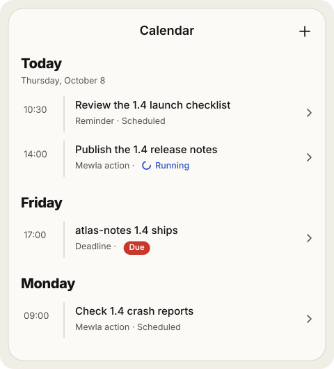

# Calendar

Calendar is Mewla's view of time: what happens when. Open it from the menu
(☰, or the sidebar on a wide screen). It lives on the daemon and syncs to the
app, so it belongs to the current server like everything else.

## Item kinds



| Kind | Has | What happens when it is due |
| --- | --- | --- |
| Event | A start and an end | Shows as running during the interval, then completes |
| Reminder | A notify time | Your phone shows a notification and the item waits for you |
| Deadline | A due time | The item waits for you |
| Scheduled action | A due time and an instruction | An agent runs the instruction as Work and reports back to Brain |

In the app, an item that waits for you shows the red **Needs you** mark;
running, done, failed and cancelled items use the same marks as Work. Each row
says what the item does in one line.

Open an item to see:

- its schedule in words ("Every day at 8:30 PM · Next: tomorrow 8:30 PM"),
  with the timezone only when it differs from your phone's;
- what it does, in one line; a scheduled action's full instructions are one
  tap away under **Instructions**;
- its runs, newest first: the date, how it went and the first line of what it
  produced. Tap a run to read its whole result, or why it failed. A run still
  in progress opens its live Session, and so does tapping a running item in the
  agenda.

You enter a local date, a local time and a timezone. Items can repeat daily,
weekly or on weekdays, and keep their local time across daylight-saving
changes. A time that does not exist on a daylight-saving day is rejected; a
time that occurs twice asks you to choose the first or second occurrence.

## Scheduled actions

A scheduled action is a small job for an agent: "At 09:30 on weekdays,
summarise yesterday's merged pull requests." When it is due, Mewla:

1. creates a visible Work item and starts the agent in its own Session, on
   Brain's executor;
2. waits for that Work to finish or fail;
3. posts the result to the Brain thread where you created the action, and
   sends one push notification that opens that thread.

The Work and the Session it starts say where they came from: a calendar glyph
and the schedule's name and date ("运营：挖稿 · Oct 27") on the Work rail, the
Work page, the Session's row in Sessions and the Session's header. Tap it to
open that run in Calendar.

Each occurrence runs at most once, even across daemon restarts. A recurring
action moves on to its next time after a success or a failure; the failed run
keeps the reason, and the item itself is simply scheduled again. If the daemon was down when an action was due, it
runs on startup only if it is at most 15 minutes late; older ones are marked
failed so stale work does not start unexpectedly. Use **Run now** to run one on
demand.

Scheduled actions run unattended; see
[Permission bypass risks](executors.md#permission-bypass-risks).

## Reminders on your phone

After a sync, the app schedules the next reminder as a local notification, so
it still fires if the phone loses its connection to the daemon. If you deny
notification permission, Calendar keeps working and tells you notifications are
off.

## Items Mewla acts on

A reminder can belong to a part of Mewla. [Watch](watch.md#reaching-you) creates
one called "Morning brief": a daily reminder that sends Brain the brief when it
is due, instead of showing a notification. You edit it like any reminder: move
the time, change the repeat, cancel it. Cancelling turns the feature off, and
Mewla does not create it again. It has to stay a reminder, and only the daemon
can create items of this kind.

## Ask Brain or use the CLI

Brain creates calendar items when you ask for one explicitly ("remind me
tomorrow at 9"). It does not pull commitments out of every message.

From the computer:

```sh
mewla calendar list --json
mewla calendar get -id <item-id> --json
mewla calendar create -title "Review plan" -kind reminder \
  -date 2026-07-15 -time 09:30 -timezone Europe/Berlin --json
mewla calendar create -title "Summarise merged PRs" -kind scheduled_action \
  -date 2026-07-15 -time 09:30 -timezone Europe/Berlin -recurrence weekdays \
  -summary "Every weekday morning, yesterday's merged PRs in brief" \
  -instruction "Summarise yesterday's merged pull requests" \
  -source-thread <brain-thread-id> --json
mewla calendar cancel -id <item-id> -revision <revision> --json
mewla calendar run -id <item-id> --json
```

A scheduled action needs `-source-thread`, the Brain thread that receives its
result. `-summary` is the one line Calendar shows; `-instruction` is the full
prompt the agent gets. Brain writes the summary in your language. An item
without one shows the first sentence of its instruction. Events use `-end-date` and `-end-time`. `mewla calendar update` takes the
complete item as `-item-json` plus its current `-revision`, so two edits cannot
silently overwrite each other.

## Limits

Calendar does not sync with Apple or Google calendars, and has no attendees,
shared calendars or automatic scheduling.
