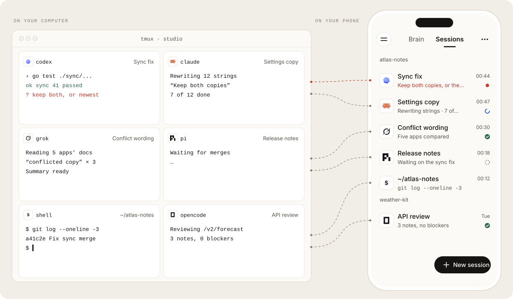
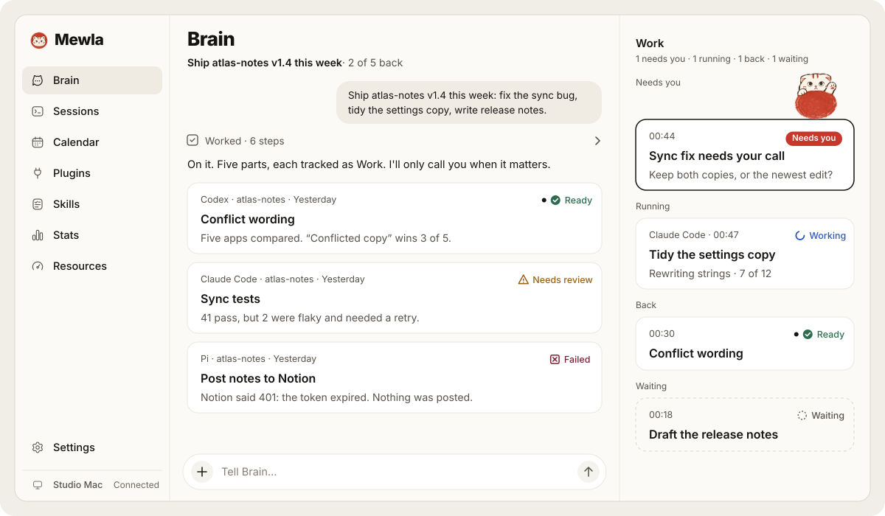

# Get started

From nothing to your first goal in about ten minutes. This page is one path;
[Install and update](install-daemon.md) and [Connect and pair](connect-and-pair.md)
cover the alternatives.

## The pieces



- **The daemon** (`mewla`) runs on your computer next to your repositories,
  `tmux` and agent CLIs. It owns Sessions, Brain, Work and pairing. One binary;
  no cloud service is required, and remote access is an opt-in sign-in.
- **The app** on Android or iOS connects to one daemon at a time. The daemon
  also serves it as a web page.
- **Your agent CLIs** (Claude Code, Codex, Cursor Agent, Grok, Pi, OpenCode)
  do the work. Mewla starts and reads them; you sign in to each yourself.

Your code, keys and agent state stay on your computer.

## What you need

- Linux (`amd64` or `arm64`), WSL2, or an Apple Silicon Mac
- `tmux` and one signed-in agent CLI; `mewla` offers to install both
- An arm64 Android phone, an iPhone, or a browser

## 1. Install the daemon

```sh
curl -fsSL https://mewla.ai/install.sh | sh
```

It verifies the release checksum, installs `mewla` without `sudo` and sends no
telemetry. If `tmux` is missing, it shows the one command for your system
(`apt`, `dnf`, `pacman`, `zypper`, `apk`, or Homebrew on a Mac) and asks
whether to run it; `sudo` asks for your own password. The last line is the
command that starts Mewla: `mewla`, or its full path when your current shell
cannot find it yet.

## 2. Start it and pair your phone

```sh
mewla
```

The first time, it checks this computer before anything else. An existing
install that never made these choices asks once, the next time you run
`mewla` in a terminal, even while Mewla is already running in the background. Without
`tmux`, it offers your system's install command. Without a signed-in agent
CLI, it offers Claude Code or Codex with their official installers, then their
sign-in (`claude auth login` or `codex login`). One ready agent is enough, and
Brain uses it. With more than one ready, it asks once which agent Brain should
use, Claude Code first; change it any time with `mewla brain use <agent>`.

Then it asks how your phone and browsers should reach this computer. Pick 1
and sign in with GitHub: the computer gets its own address, such as
`https://quiet-otter-3f9a.m.mewla.ai`, that works from any network. Last, it
asks whether to start Mewla automatically with the computer, using
[`mewla boot install`](install-daemon.md#keep-it-running).

With no device paired yet, it shows one screen: whether remote access is on,
a QR code for your phone, when the code expires, and a short link for a browser
on this computer. Install the app (the Android APK from
[Releases](https://github.com/daoleno/mewla/releases), or
[iOS on TestFlight](https://testflight.apple.com/join/nMQheDCE)), open it, tap
**Mewla already running? Scan its code** and scan. The code works once and
expires; `mewla pair` prints a fresh one. For the web UI on this computer, run
`mewla web`: it opens the browser already paired. Android asks you
to allow installs from your browser or file manager the first time you open
the APK; allow it for that app, then install.

Other ways to connect, such as the same Wi-Fi only, Tailscale or your own
HTTPS address, are in [Connect and pair](connect-and-pair.md#choose-an-address).

## 3. Start a Session

Open **Sessions**, tap **New session**, pick one of your repositories and tap
an agent. Ask it something small. Switch between **Chat** and **Terminal** from
the Session's ⋮ menu: both are the same `tmux` pane, which you can also attach
to at your desk with `tmux attach`. More in [Sessions](sessions.md).

## 4. Give Brain a goal

Open **Brain** and tell it something with a few parts, for example "Fix the
failing test in sync/, then update the changelog". Brain splits it into Work,
starts Workers you can watch in Sessions, and puts a slip in the conversation
for each part. It calls you only when a slip needs your decision. More in
[Brain and Work](brain-and-work.md).



Workers run without asking for approval. Before you leave Brain working on a
machine with secrets, read [Permission bypass risks](executors.md#permission-bypass-risks).

## Find your way

| On a phone | On a wide screen (1024 pt and up) |
| --- | --- |
| ☰ opens the menu, or swipe right anywhere on Brain; swipe or tap **Brain · Sessions** in the top bar; ⋮ holds the current page's actions | The menu is a sidebar with Brain and Sessions on top; ⋮ is the same |

The menu holds everything else, each in exactly one place: Calendar,
Extensions, Stats, Resources and Settings.

## Next

- Keep the daemon running across reboots: [Install and update](install-daemon.md#keep-it-running)
- Reach it from anywhere, add a tablet or a browser: [Connect and pair](connect-and-pair.md)
- Get a push only when something needs you, or talk to Brain from Telegram: [Notifications and Telegram](notifications.md)
- Choose models and keys, or lock agents down: [Agents and models](executors.md)
