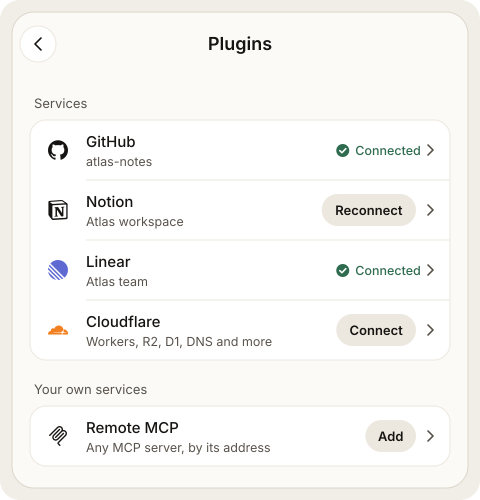

# Plugins

Plugins connect Brain and its Workers to services you use: Linear, Notion,
GitHub, Slack, Cloudflare, Onlora for generating and finding assets, Hyperliquid for markets and trading, and custom MCP or OpenAPI
services. Plugins are a **preview**.

Connected accounts belong to the current server. Switching servers in the app
shows that server's accounts and never moves an account between servers.

## Connect a service



1. Open the menu and choose **Extensions**. Mewla's plugins come first, one
   row per service.
2. Tap **Connect** on the service's row.
3. Sign in on the service's own page and approve Mewla.
4. You land back on Extensions with the service **Connected**. Brain can read and
   search it right away.

The card at the top of Extensions follows the sign-in: **Waiting for Linear**
while you are on the service's page (with **Open Linear again** and **Cancel**),
then the result. It adds nothing while you wait. After a connect it offers **Allow changes too**; you can skip
it and allow changes later on the service's page.

From the web UI, the service returns your browser tab to the web UI's own
Extensions page. From the phone app it returns to the app.

If a sign-in comes back without connecting, the card names the step that
failed: the service didn't complete sign-in, didn't accept it, its tools
couldn't be loaded, or this server couldn't save the account. The daemon log
has a matching `plugins:` line with the cause, never a credential. Connect again
after fixing the cause.

For GitHub, Mewla shows a device code in large type; tap **Copy code and open
GitHub** and enter it on GitHub's page. You can also choose **Use the GitHub
login on this server**, which imports the account the GitHub CLI (`gh`) is
signed in to on your computer. Mewla shows the identity first and copies it only
after you confirm.

There are no tokens, client IDs or callback URLs to type for sign-in services.

## Sign-in availability

First-time sign-in is not yet available for every service, because some need
Mewla's own app registration with the provider:

| Service | Sign-in | From the web UI |
| --- | --- | --- |
| Linear | Official browser sign-in | Returns to the web UI's Extensions page |
| Notion | Official browser sign-in | Returns to the web UI's Extensions page |
| Onlora | Onlora's sign-in, by email link; a new Onlora account needs an invite code | Works when the web UI is on an `https://` address or on this computer (`http://127.0.0.1`), and returns to its Extensions page |
| Cloudflare | Cloudflare's official MCP server (`mcp.cloudflare.com`). Its page asks which permissions to grant, **Read only** unless you choose more. Cloudflare accepts only web addresses, so from the phone app it returns through Mewla's page at `connect.mewla.ai`, which hands the result straight back to the app | Works when the web UI is on an `https://` address or on this computer (`http://127.0.0.1`), and returns to its Extensions page |
| Remote MCP | The server's own sign-in, or a token | Returns to the web UI's Extensions page |
| GitHub | Device code, or import from `gh` | Code page opens in a new tab; Extensions updates when you're done |
| Slack | Official Slack sign-in from the phone app, in any Slack workspace. Your workspace may ask an admin to approve Mewla first | Slack's app returns only to the Mewla app: connect Slack from the phone |
| Hyperliquid | No sign-in and no setup to read; one API wallet key you paste to let Brain trade | Works everywhere; the key field is on the service's page |

A service that cannot be connected yet shows **Not yet available** with a short
reason. Accounts you already connected keep working.

Mewla has no Google plugins. Google Calendar and Gmail were removed, as was the
older Google Workspace plugin: when a server starts it signs out of any Google
account still connected there and deletes the account and its saved token.
Mewla's own [Calendar](calendar.md) is not a plugin and is unaffected. fal and
Image generation were removed the same way. Onlora generates images, speech and
video.

## What Brain can do

Tap a service's row to open its page. Every connected account is listed there,
each with its status and two switches:

- **Read and search**: on after sign-in.
- **Make changes when asked**: off until you turn it on. If the service only
  granted read access, the switch is an **Allow** button instead: the service
  asks you once more, then the switch is on.

[Watch](watch.md) reads GitHub and Linear through these same switches: it uses
only read tools you allow, and its reads don't show up as recent calls.

**Tools & activity** lets you allow or block single tools, inspect a tool's
schema, run a status check and see recent calls. Every switch takes effect on
the tap, with no confirm. The tools are one list: **All tools** leads it with
a switch over every tool, and each group (Read and search, Make changes, and
Other tools that Mewla hasn't reviewed) starts with a row holding its own
switch, in the same column as the tools' switches. A partly allowed list reads
off, with its count beside it: a tap allows the rest, and once all are on a
tap turns them all off. When the service still has to approve changes, All
tools leaves them off and reads on once everything else is allowed; turning on
Make changes asks the service first.

A service can add or change its tools at any time. For an MCP service, Mewla
reads the list again on every call, when it announces a change, when you open
the service's page or Brain describes a tool (at most once a minute), and
whenever Brain asks for updates. Tools that did not change keep working. A new
tool, or a new version of a tool you had allowed, waits for you: Extensions and
the service's page show **<Service> updated N tools** with the tool names, and
one **Confirm** allows exactly those. A new version counts even when only the
description changed, because the description is what Brain follows. Until then
Brain gets "this tool was updated", with the `confirm-updates` command that
clears every waiting update on the account, never a sign-in error, and the
account stays **Connected**. A changed tool you had blocked stays blocked
without asking, and a tool that changes back to the version you allowed needs
nothing. A tool the service removes leaves the list and loses its permission.

Permission is not an instruction. Even with changes allowed, Brain should send
messages or update records only when the task you gave it calls for that.
Writes are never retried automatically.

An account's status is **Connected**, **Needs sign-in again**, **Off** or
**Last call failed**. When an account needs something, its row on Extensions and
its card on the service page show one action: **Reconnect** when sign-in
expired, **Turn on** when it is off, **Check again** after a failed call, or
**Retry** when removing its credentials did not finish.

To add a second account, use **Add another account** at the bottom of the
service's page. It is the same sign-in as Connect.

## Cloudflare

Cloudflare's MCP server covers the whole Cloudflare API with a few tools:
**search** finds an API endpoint, **docs** searches Cloudflare's docs, and
**execute** calls the API. Read and search covers search and docs. Execute sits
under **Make changes when asked**, so turn that on before Brain reads anything
from your account, and it can only do what you granted on Cloudflare's page; to grant more, disconnect and connect again, choosing more
permissions there.

## Hyperliquid

Hyperliquid needs no setup to read. Every server has one **Hyperliquid** account
(mainnet, **Read only**) from the start, so Brain can read markets, prices,
order books and an account's positions, orders, fills and PnL right away. It
takes the address from your conversation and can remember it itself; positions
and balances on Hyperliquid are public, so no key is involved. The account
stays: you can switch it off, and a trading key comes and goes without
touching it.

Trading is a separate, optional step. To let Brain trade, open **Hyperliquid**
in Extensions, tap **Add API wallet key** under **Trading**, and paste one **API
wallet key**. Create the API wallet on Hyperliquid's own site
(`app.hyperliquid.xyz/API`; **Create an API wallet** opens it), approve it, and
paste its private key once. Never paste your main wallet's key: Mewla refuses
it. Mewla asks Hyperliquid which account the key trades for and on which
network, so there is no address or network to fill in. The account shows the
address it trades for (**0x1234…abcd**), and every tool result names its
network. A mainnet key turns the read-only account into that trading account; a
testnet key (Hyperliquid's practice network, test money only) adds a separate
**Hyperliquid Testnet** account, tagged **Testnet** on its card. A key is
saved with the one account it was approved for and never used on the other
network.

An API wallet can sign trades but not withdrawals or transfers out; those need
your main wallet's own signature, and Mewla has no code that makes them. A
leaked API wallet can still trade, and Hyperliquid also lets an API wallet
deposit into a vault, so it can move value that way; use a fresh one, and remove
it on Hyperliquid's site if it is ever exposed. The key stays on the server in the
private vault, is never shown or logged, and **Remove trading key** on the
account deletes it and leaves the account reading as it was. The mainnet account
has no Disconnect; only a testnet account does.

Adding a key for an account that is already connected updates that account.

**Read and search** (on after you connect): `list_markets`, `get_mids`,
`get_book`, `get_candles`, `get_funding_history`, `get_account` (positions,
margin and spot balances), `get_open_orders`, `get_fills`,
`get_funding_payments`, `get_portfolio`, `get_vaults` and `get_order_status`.
Account tools take an optional `address`; the read-only account has none of its own, so Brain names one with each read, and a trading account defaults to its own. Times
come back with a readable `…_at` field in the time zone you name (`timezone`),
this computer's own if you don't. Results are bounded: lists are one page and say when they were
cut.

**Make changes when asked** (off until you turn it on, and only with a saved
key): `place_order`, `modify_order`, `cancel_order`, `set_leverage` and
`schedule_cancel`. Brain places an order only when you ask for it. Each result
says which network it used and returns exactly what was signed and sent, with
Hyperliquid's own reply and order id. Prices and sizes are never rounded for
you: a price with too many digits is refused before anything is sent, with a
valid example. An order is sent once and never retried; if Hyperliquid does not
answer, check `get_open_orders` or `get_order_status` before trying again.

Not supported: withdrawals, transfers, vault deposits, market orders and
trigger orders, builder-deployed (HIP-3) markets, and sub-accounts. Hyperliquid
limits one IP to 1,200 request weight a minute; Mewla does not retry when it
says so.

## Custom services

Under **Your own services** you can add an MCP server or an OpenAPI service by
endpoint or document. Custom endpoints must be public HTTPS by default. To reach
a service on your own network, grant that account an explicit address range;
cloud metadata and link-local addresses are always refused. Custom services get
no automatic permissions: after connecting one, choose its tools.

## Turn a plugin off

Each account on a service's page has an on/off switch next to its status. Off
hides every tool of that account from Brain and Workers: `mewla connections
search` skips it, and `describe` and `invoke` refuse it. The sign-in, Read and
search, Make changes and per-tool choices stay as they were, so turning it back
on restores the same tools. Extensions shows the service as **Off** when every
account on it is off.

## Disconnect

On the service's page, tap **Disconnect** on the account and confirm on the same
card. (Hyperliquid's mainnet account has none; it is switched off instead.) Mewla disables the account first, so later calls fail even if revoking it
at the provider needs a retry. Some providers do not support revocation from
Mewla; in that case also remove Mewla's access in the provider's settings.

## Use plugins from the computer

Brain and Workers use the same accounts through the CLI:

```sh
mewla connections list --json
mewla connections search --query github --json
mewla connections describe --id ACCOUNT_ID --json   # every tool: name and description
mewla connections describe --id ACCOUNT_ID --tool get_me --json
mewla connections invoke --id ACCOUNT_ID --tool get_me --args '{}' --json
mewla connections invoke --id ACCOUNT_ID --tool add_asset --args-file asset.json --json
mewla connections policy --id ACCOUNT_ID --tools get_me,list_issues --allow
mewla connections resources --id ACCOUNT_ID
mewla connections read-resource --id ACCOUNT_ID --uri onlora://projects/PROJECT_ID
mewla connections updates --id ACCOUNT_ID
mewla connections confirm-updates --id ACCOUNT_ID --tools generate_image,write_file
```

`policy --tools` sets every listed tool in one change: all of them, or none
if any name is unknown. Leave out `--allow` to turn them off. `describe`
without `--tool` lists every tool on the account. Inline `--args` stays small;
put a large payload (up to 8 MiB, such as `add_asset`'s base64 asset) in a file
and pass `--args-file path`.

When arguments do not fit the tool's input schema, the error names the
failing argument path and the constraint it broke (for example
`items: maxItems: array length 9 is greater than 8`), so a call can be fixed
without re-reading the whole schema.

Each call is one bounded request; nothing pages automatically.

- **Resources.** An MCP server can publish documents next to its tools, such as
  an Onlora project. `resources` lists them and their URI templates;
  `read-resource` reads one. Reading needs the account on and at least one read
  tool allowed (any allowed tool for a custom service).
- **Errors.** When a service rejects a call, its own message comes back,
  shortened to 2,000 bytes with credentials removed.
- **Time.** A call may take two minutes, or longer when its arguments ask the
  service to wait (`wait_s` and similar), up to ten minutes. If time runs out,
  the call may already have run: Mewla never retries it, and you should check
  its state with a read tool before calling again. Calls on the same account
  run side by side.
- **Updates.** `updates` asks the service for its current tools and shows
  those waiting for confirmation; `confirm-updates` and `dismiss-updates` act
  on the listed tools, all or none, and only with the person's consent.

## Where credentials live

Tokens stay on the daemon, in a private vault file readable only by your user.
Account history records which tool was called and when, but not tokens,
arguments or results.

Mewla only connects a plugin to public addresses, so a name that resolves to your
own network is refused. One exception: a proxy app in fake-IP mode (Surge, Clash
and similar) answers every lookup with an address in `198.18.0.0/15` and routes
by name, so Mewla connects to a *name* that resolves there. HTTPS still checks
the certificate for that name. If your network answers with some other private
address, the connection fails with "this network answers with a private address".
