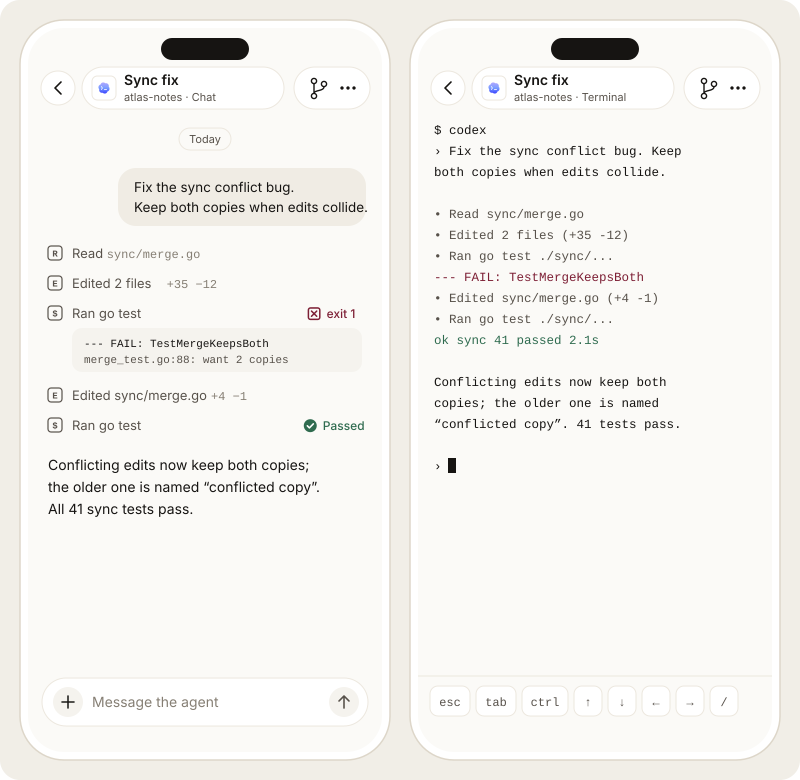
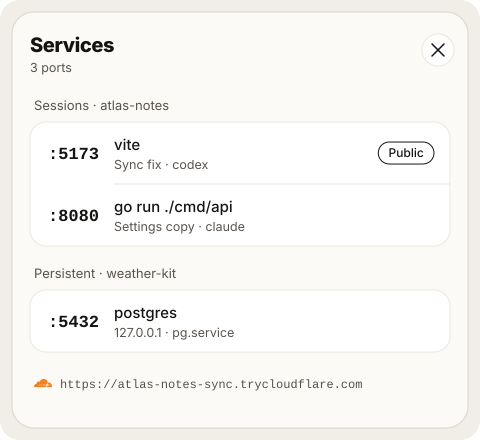

# Sessions

A **Session** is one agent or shell running on your computer in Mewla's session
host. Mewla starts it, lists it and lets you read or drive it from the phone.
The session host keeps it running while Mewla restarts or updates, and the same
Session is there when you sit down at the desk: `mewla attach` lists the live
ones to pick from (or `mewla attach <name>` goes straight in), and Ctrl-\
detaches. `mewla host status` lists them in full.

Sessions an earlier Mewla started in `tmux` move to the session host when their
agent is idle; see [Updating from Mewla 0.2](install-daemon.md#updating-from-mewla-02).

## Start a Session

In **Sessions**, tap the **New session** pill (or ⋮ > **New session**; in a
desktop browser, the **+** at the top or the N key), pick a directory and tap
what to run:

| Choice | Runs |
| --- | --- |
| Claude, Codex, Cursor, Grok, Pi, OpenCode | That agent CLI, using the command from [Agents and models](executors.md) |
| Shell | Your login shell |
| DSH | The DSH harness, opened as a web page rather than a terminal |

**Advanced** lets you set the working directory, any command (for example
`claude --model opus`) and a window title.

The agent must already be installed and signed in on the computer; Mewla never
signs in for you.

## The list

Sessions are grouped by directory. Each row shows the agent, the Session's
name, its latest line and, on the right, its state mark: a spinning arc while
it works, a red dot when it needs you, a crossed box when it failed, a check
when it finished.

Tap a directory's name to fold it. A folded directory keeps its Session count
and the most urgent mark among its Sessions (needs you, then failed, then
running), so nothing waiting on you hides. Folds are remembered per computer.

Brain's Workers are ordinary Sessions and appear here too. Long-press a row to
select several and terminate them together.

## Chat, Terminal and Git



Open a Session to read it in one of three ways:

- **Chat**: the structured conversation, with your messages, the agent's
  replies, tool calls, plans and attachments. A run of finished tool calls
  folds into one row that says what it did ("Read 3 files and ran 2
  commands"); tap it for the calls. A call that failed is folded like any other
  and the row says so ("4 steps · 1 failed"); a call that is running or waiting
  on you stays on its own row, and so does a subagent, which reads as the task it was given. On Claude, tap a subagent to see the calls it made, folded the same way, with how many there were, how long it took and whether it is still working. Available for Claude, Codex, Cursor, Grok, Pi and OpenCode.
- **Terminal**: the live terminal, rendered natively. Works for any command,
  including a Shell. A key row above the keyboard adds Ctrl, Esc, Tab and arrows.
- **Git**: read-only All, Working and Staged diffs for the Session's
  repository. Reading a diff never stages or discards anything.

What you type in either Chat or Terminal goes to the same terminal.

### Copy from the Terminal in a browser

Select text with the mouse and press **Cmd+C** on a Mac, or **Ctrl+C** or
**Ctrl+Shift+C** on Windows and Linux; the text goes to your computer's
clipboard. With nothing selected, Ctrl+C still interrupts the program (on a
Mac it always does), and right after a Ctrl+C copy the next Ctrl+C interrupts
again. A program that uses the mouse, such as `tmux`
with `mouse on`, `vim` or an agent's interface, keeps plain drags for itself:
hold **Shift** (**Option** on a Mac) while you drag to select instead. What
`tmux` copies when you select with it, and what a program copies with the
terminal's clipboard code (OSC 52), reaches the browser's clipboard too, on
`localhost` or an HTTPS address; programs inside `tmux` need `set -g
set-clipboard on` for that. Mewla never lets a program read your clipboard.

### When an agent is waiting for you

A waiting prompt is either a card you can answer by tapping, or no card at all.
Every card is read from the prompt the agent has open in its terminal and is
answered by Mewla, which checks the screen is still showing that same prompt
before it presses a key. When a Session is blocked on a prompt Mewla cannot
answer this way, the Session opens on its live **Terminal** instead. Going back
to the chat leaves it there until the Session is blocked on something else.
Brain's chat shows the same cards for the prompts Brain itself is blocked on.

**Claude's questions** (AskUserQuestion) show a card above the composer. It
works like Claude's own prompt: one question at a time, with a tab for each
question and a final **Review** tab. Tapping an option on a single-choice
question moves on to the next question. Where a question allows several
options, tick any and tap **Next**. Type your own answer in the **Type
something** row. Review lists every answer; tap a row or a tab to change it,
then tap **Submit**. Questions you have not answered are marked there, and the
button counts them. The Working row is hidden while a question is open. Once it
is answered, from the card or from the Terminal, the card becomes an
**Answered** line in the chat. Mewla answers by pressing keys in the Session's
terminal, so it needs to see the whole question there: when the Terminal window
is shorter than the question (a long multi-question card, a keyboard open over
the Terminal), sending says the window is too short rather than that the
question has passed. Make it taller or close the keyboard and send again.

**Permission, plan, startup and approval prompts** (run this command, accept
this plan, trust this folder, a Codex approval) show a card with the prompt's
own heading, what it asks about, and one button per numbered option, labelled as
the agent labels it. Tapping a button answers that option.

If the prompt has already passed (answered in the Terminal, replaced by another,
or timed out), Mewla says **This prompt has already passed** and the card goes
away. If Mewla cannot send the answer, it says so on the card and the card
stays, so you can try again.

When Claude, Codex or OpenCode asks to run a command or change files, and Mewla
started that Worker, the card names the command and offers the agent's own
options (Allow or Deny; OpenCode also offers Always allow). Tapping one answers
the agent directly, and a request that was already answered, or that belongs to
another conversation, is refused.

### Copy and edit a message

Press and hold one of your messages on the phone, as in the ChatGPT and Claude
apps, and a small menu opens next to it: the time it was sent, then **Copy**,
**Select Text** and **Edit**. The menu follows the message, opens above or below
it depending on the room, stays clear of the keyboard, and closes when you tap
elsewhere, scroll or press Back. A very long message anchors the menu to where
you pressed.

Replies keep the system's own text selection: press and hold a word, drag the
handles, tap a link. Under every reply a quiet row shows **Copy** and a **...**
menu with **Copy** and **Select Text** (the message in a sheet, for selecting a
whole block at once). On desktop, hover over
a message for Copy and Edit; right-click and text selection are the browser's
own. Copy gives the text as written, Markdown included; code blocks keep their
own copy button. Each button is a 44 dp target that commits when you lift your
finger, so a slightly drifting tap still counts.

Messages are read as standard GitHub-flavored Markdown on every platform:
headings, quotes (including a line that continues a quote without its `>`),
nested and numbered lists, task lists, tables, strikethrough, links and bare
URLs, HTML entities such as `&amp;`, images, code blocks with a copy button,
and Mermaid diagrams. A reply that is still arriving never shows half-typed
syntax: an unfinished `-`, `1.` or `>` waits for its text.

**Edit** puts the message in the composer with a small bar above it and an x to
cancel. What sending does depends on the agent:

| Agent | Sending an edited message |
| --- | --- |
| Claude Code, Codex, Pi | Steps the agent's conversation back to that message, as the agent's own message-editing gesture does, and sends the text from there. The later turns leave the chat. Files the agent changed stay as they are. |
| Every other agent, and Brain | Sends the text as a new message. Nothing earlier changes. |

Mewla rewinds only when the agent is idle and its own message list is showing
the message you chose. If it cannot prove that, nothing is rewound or sent, and
the text waits in the composer as a new message you can still send. Brain's own
thread is never rewound.

### Files in a reply

Tap a file path in a reply, a tool row or a changed-files list to open it
without leaving the chat: Markdown and text are shown as text, images can be
zoomed, and PDFs open on the phone. Video (mp4, m4v, mov, webm) and audio
(mp3, m4a, wav, ogg, opus, flac) play right there with play/pause, a
scrubber you can drag to seek, the time, mute and, for video, full screen.
Playback streams from the computer, so a long recording starts at once and
seeking does not download the whole file. The header offers Download for any
file; text files (Markdown, code, txt, JSON) also offer Copy, which copies the
whole file content. Images and binaries have no Copy — download them instead.

Links in a reply work the same way. Web addresses, with or without
`[text](…)`, open in your browser, including one that sits right beside Chinese
text or punctuation, and email addresses open your mail app. A link that
names a file, such as `[report](report.pdf)` or `[app](./out/app.apk)`, opens
that file as above, and the header's Download saves it. Inside a Markdown file
you opened, a link to another file is relative to that file. Links that can run
code (`javascript:`, `data:`) never open.

A file that is not really what its name says (an `.mp4` that is not an MP4
container, say) is not played. A codec the device can't decode, such as HEVC
in some browsers, shows "can't be played here"; download it instead.

A Session's ⋮ menu holds:

| Item | Does |
| --- | --- |
| Open terminal / Open chat | Switch between the two views |
| New Terminal | Start a Shell in the same directory |
| Rename | Change the Session's name |
| Model | Pick the model for this Session only |
| Open Web | Open a DSH Session's web page |
| Open Brain | Jump to the Brain conversation about this Worker's Work |
| Terminate | Stop the Session, after you confirm |

Items appear only where they apply: Open Web for DSH, Open Brain for a Worker.

## How Mewla follows each agent

Where an agent offers a way to be followed, Mewla uses it instead of reading
the screen or the agent's files:

| Agent | Followed through | Messages and Stop |
| --- | --- | --- |
| Claude Code | Its hooks, set when Mewla starts it | Typed into the Terminal; the hook confirms delivery |
| Codex | An app-server beside the Terminal, set when Mewla starts it; the conversation is read from the thread Codex announced, and the Status sheet asks the same app-server (account, usage limits, model, approvals, sandbox, token use) | Sent to Codex directly |
| OpenCode | OpenCode's background service: one event stream for all Workers, the session id chosen at launch | Sent to the service directly; a message to a session OpenCode has not created yet (its first) is typed |
| Pi | A small extension Mewla loads into each Pi it starts (`pi -e`), which reports Pi's turns over a local socket; the session file is chosen at launch | Handed to Pi by the extension; Stop aborts the running turn |
| Cursor | The chat is created before Cursor starts and resumed, so its transcript is known from the first moment; turns are read from the transcript and the screen | Typed into the Terminal |
| Grok, dsh | The agent's transcript and the screen | Typed into the Terminal |

A Worker that Mewla did not start, or that started with its own settings, is
followed from the transcript and the screen, and the app offers only what that
supports. For Codex that is the one case still found by looking: a Codex you
opened by hand has no app-server of Mewla's, so its conversation is matched by
folder, start time and the files it holds open, and its Status sheet says to
type `/status` in the Terminal. A Codex that Mewla started is not looked for
at all: until it announces its thread (a moment after it starts) there is
nothing to read, and only if it has not announced one after 30 seconds is its
transcript searched for.

Folder trust follows the same rule. Codex is trusted for a Worker's folder by
the Worker's own command line, so Mewla leaves your Codex config alone. Claude Code
has no per-launch way to do that, so for Claude Workers Mewla sets that one
folder's `hasTrustDialogAccepted` in Claude's own config, which is the key
Claude itself names for it. A Claude Brain host gets the same for the Brain
workspace, so a first launch on a new machine does not wait at the dialog.

Cursor and Grok can only be hooked through the user's own global
configuration, and Mewla never writes to it. They stay on the transcript and the
screen, and so does anything an agent offers only through such a file.

## `tmux` inside a Session

Sessions run in the session host, not in `tmux`, so a `tmux` command an agent
runs, `tmux kill-server` included, cannot end them. Worker and Brain Sessions
point `TMUX_TMPDIR` at their own scratch directory, so a plain `tmux` there
starts a server of its own.

## What the daemon costs while idle

The daemon watches your Sessions by listing them and reading the process table,
not by attaching to them. With nothing happening it settles to under 1% of one
CPU core (it was above 6% when it forked `ps` several times a second):

- The process table is read straight from `/proc` on Linux (`ps` elsewhere), and
  again only when a Session printed, appeared or went away, or when it is five
  seconds old.
- A Session's screen is read again only when the session host says it printed,
  or when the last read is 30 seconds old.
- After three quiet seconds the Session list is checked every two seconds
  instead of every half second; the first change brings the fast cadence back.

## Services



Agents start dev servers, previews and APIs. **Services**, in the Sessions ⋮
menu, lists the ports they listen on, by project:

| Source | Shown when |
| --- | --- |
| Session | A process inside a live Session listens on a port. The row opens that Session's terminal. |
| Persistent | A registered user `systemd` unit is running and listening. It has no terminal. |

Mewla finds the listening ports itself (from `/proc` on Linux, through `lsof`
on macOS), so no `ss` or other tool needs to be installed on Linux. It sees the
processes your user owns.

A service bound only to `127.0.0.1` is marked local; Mewla does not invent a
network URL for it. A registered unit that stopped shows **Inactive**; one
whose state cannot be read shows **Error** with the reason.

### Keep a service after its Session ends

A service started outside a Session, such as a user `systemd` unit, stays hidden
until you register it. Registering never starts, stops or changes the unit:

```sh
mewla service register -unit my-preview.service -name "Docs preview" \
  -project docs -port 3080 -cwd ~/projects/docs
mewla service list --json
mewla service unregister -unit my-preview.service   # removes the registration only
```

Only plain user unit names are accepted. Registrations survive daemon restarts
and Worker cleanup, and Mewla checks on every refresh that the unit is running
and owns the port. This needs Linux with a user `systemd`.

### Share one with a temporary public URL

A service row can start a Cloudflare **Quick Tunnel**: a random
`trycloudflare.com` URL for that one service. It needs `cloudflared` on the
computer, but no Cloudflare account.

- **Anyone with the URL can reach the service.** Do not tunnel anything that
  holds secrets or has no login of its own.
- Mewla starts a tunnel only when you tap it, and first checks that the
  service answers HTTP.
- The tunnel follows the process that owns the port: if it exits, the tunnel
  stops. Stopping a tunnel never stops the service.
- URLs live in memory only. After a daemon restart there is no tunnel until you
  start one again.
- Cloudflare limits Quick Tunnels to 200 concurrent requests and does not
  support Server-Sent Events.

Mewla runs `cloudflared` with an empty configuration and never touches your own
named tunnels or `~/.cloudflared`. It learns the URL and when the tunnel is
connected from `cloudflared`'s own metrics endpoint on a loopback port, not by
reading its output. Quick Tunnels need a Linux daemon.

From the computer, with the ID and generation from `mewla service list --json`:

```sh
mewla service tunnel start  -id SERVICE_ID -generation PROCESS_GENERATION
mewla service tunnel status -id SERVICE_ID -generation PROCESS_GENERATION
mewla service tunnel stop   -id SERVICE_ID -generation PROCESS_GENERATION
```
